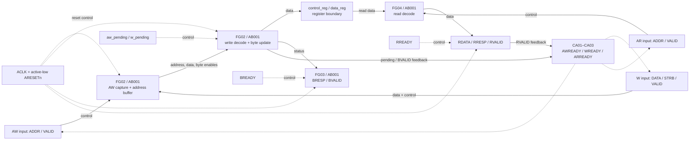
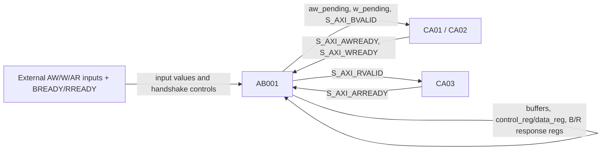
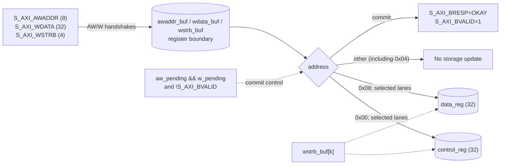
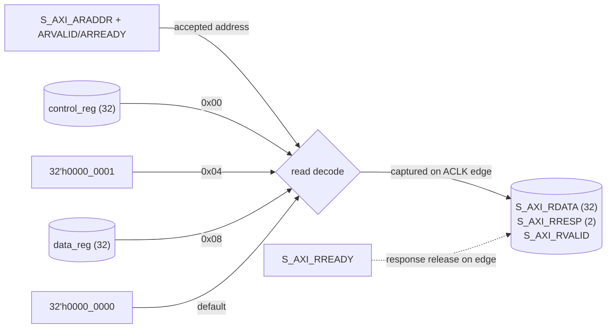

# RTL Architecture Document — `axi_lite_regs`

- **Source revision:** `90d46c1568586c0d4c4c59f1eb43990395c2e94d` (repository `HEAD`; working tree contains untracked lesson files)
- **Analysis date:** 2026-11-01
- **RTL files:** [`axi_lite_regs.v`](./axi_lite_regs.v)
- **Testbench / trace inspected:** [`tb_axi_lite_regs.v`](./tb_axi_lite_regs.v), [`wave.vcd`](./wave.vcd)
- **Scope:** Static review of the complete 72-line Verilog-2005 DUT plus its single directed testbench and supplied Icarus VCD. No packages, includes, parameters, submodules, build defines, synthesis output, or specification beyond the neighboring README were present.
- **Limitations:** No elaboration, lint, formal, CDC, or hardware validation was performed. The VCD represents only the provided directed test; testbench stimulus covers AW/W arriving together, not the independent arrival orders the RTL comments say it supports. Treat this as a functional aid, not AXI compliance certification.

## 1. Module Overview

| Field | Description |
|---|---|
| Module name | `axi_lite_regs` |
| Purpose | Small, single-clock AXI-Lite-style register bank with separate write-address, write-data, write-response, read-address, and read-response channels. |
| Source | [`axi_lite_regs.v`](./axi_lite_regs.v), module declaration line 2 |
| Revision | Repository `HEAD` listed above; no source-specific tag or commit was available. |
| Parameters | None. |
| Interfaces | 8-bit byte addresses, 32-bit write/read data, 4-bit write strobes, AXI-Lite-style VALID/READY and 2-bit responses. |
| Clock | `ACLK`; the testbench toggles `clk` every 5 ns (100 MHz). No hardware clock rate is specified. |
| Reset | `ARESETn`, active-low and **synchronous**: tested only inside `always @(posedge ACLK)` (lines 26–33). |
| Clock domains | One clocked domain, `ACLK`. No CDC circuitry or asynchronous inputs are identified in the supplied RTL. |
| Dependencies | Verilog-2005; no external modules or packages. Testbench uses Icarus-compatible system tasks. |
| Main functions | Gate channel readiness; buffer AW and W independently; commit one write and update byte lanes; return an OKAY write response; decode read addresses and return data; hold a read response until accepted. |

### Register map

| Byte address | Register | Access | Behavior |
|---|---|---|---|
| `0x00` | `control_reg` | Read/write | Reset to zero; writes update only strobed byte lanes. |
| `0x04` | STATUS | Read-only mock | Reads return constant `32'h0000_0001`; writes are ignored but still receive OKAY. |
| `0x08` | `data_reg` | Read/write | Reset to zero; writes update only strobed byte lanes. |
| Other | Reserved | — | Writes ignored with OKAY; reads return zero with OKAY. |

### Verified operating sequence

1. At each rising `ACLK` edge with `ARESETn == 0`, state and response outputs are synchronously reset.
2. AW and W handshakes independently capture address and data/strobes. Readiness prevents accepting another item on the same subchannel while its pending flag is set or a write response is outstanding.
3. Once both pending flags are already set and no B response is active, the process updates the addressed register (if writable), clears the pending flags, and raises `S_AXI_BVALID`.
4. A B response remains valid until a rising edge samples `S_AXI_BVALID && S_AXI_BREADY`.
5. An AR handshake captures the selected read value and raises `S_AXI_RVALID`; the read response remains valid until a rising edge samples `S_AXI_RVALID && S_AXI_RREADY`.

The testbench uses simultaneous AW/W stimulus, one transaction at a time, and no response backpressure beyond a short delay. It checks initial values, constant STATUS, full writes, one masked byte write, and ignored STATUS writes ([`tb_axi_lite_regs.v`](./tb_axi_lite_regs.v), lines 62–76). Independent AW/W arrival and prolonged backpressure are RTL-supported claims/comments, not demonstrated by this trace.

## 2. Interface Reference

All port declarations are at [`axi_lite_regs.v`](./axi_lite_regs.v), lines 3–10. Signals are sampled/updated in the `ACLK` domain unless they are purely combinational outputs derived from state.

| Signal(s) | Direction | Width | Domain | Description |
|---|---:|---:|---|---|
| `ACLK` | Input | 1 | Clock | Rising-edge clock. |
| `ARESETn` | Input | 1 | Synchronous control sampled on `ACLK` | Active-low reset; no asynchronous reset event. |
| `S_AXI_AWADDR` | Input | 8 | ACLK interface | Write byte address; captured on AW handshake. |
| `S_AXI_AWVALID` / `S_AXI_AWREADY` | In / out | 1 / 1 | ACLK interface | AW request / combinational readiness. |
| `S_AXI_WDATA` | Input | 32 | ACLK interface | Write payload; captured on W handshake. |
| `S_AXI_WSTRB` | Input | 4 | ACLK interface | Byte enables for the write. |
| `S_AXI_WVALID` / `S_AXI_WREADY` | In / out | 1 / 1 | ACLK interface | W payload request / combinational readiness. |
| `S_AXI_BVALID` / `S_AXI_BREADY` | Out / in | 1 / 1 | ACLK interface | Write response valid / response acceptance. |
| `S_AXI_BRESP` | Output | 2 | ACLK interface | Set to `2'b00` (OKAY) for each committed write; reset to zero. |
| `S_AXI_ARADDR` | Input | 8 | ACLK interface | Read byte address; decoded at AR handshake. |
| `S_AXI_ARVALID` / `S_AXI_ARREADY` | In / out | 1 / 1 | ACLK interface | Read request / combinational readiness. |
| `S_AXI_RDATA` | Output | 32 | ACLK interface | Registered read result; reset to zero. |
| `S_AXI_RRESP` | Output | 2 | ACLK interface | Set to `2'b00` on read acceptance; reset to zero. |
| `S_AXI_RVALID` / `S_AXI_RREADY` | Out / in | 1 / 1 | ACLK interface | Read response valid / response acceptance. |

The names and handshake pattern are AXI-Lite-like; no full protocol-compliance claim is made. The RTL uses exact address matches `0x00`, `0x04`, and `0x08`.

## 3. Functional Architecture

The three `assign` statements are continuous combinational readiness equations (lines 20–24). All sequential behavior is in one concurrent process, `AB001`; the group split below describes responsibilities inside that process, not separate processes.

| Group | Name | Responsibility | Important inputs | State / outputs | Blocks |
|---|---|---|---|---|---|
| FG01 | Channel readiness | Prevents overlapping outstanding write/read requests. | `aw_pending`, `w_pending`, `S_AXI_BVALID`, `S_AXI_RVALID` | `S_AXI_AWREADY`, `S_AXI_WREADY`, `S_AXI_ARREADY` | `CA01`–`CA03`, `AB001` |
| FG02 | Write capture and register update | Captures AW and W separately; combines pending halves; selects register and applies `WSTRB`. | AW/W channel ports, pending flags, BVALID | `awaddr_buf`, `wdata_buf`, `wstrb_buf`, `control_reg`, `data_reg`, pending flags | `AB001` |
| FG03 | Write response | Generates OKAY B response on commit and holds valid until accepted. | Pending flags, `S_AXI_BVALID`, `S_AXI_BREADY` | `S_AXI_BVALID`, `S_AXI_BRESP` | `AB001` |
| FG04 | Read decode and response | Captures register/constant/default data on AR handshake and holds response. | AR channel, `control_reg`, `data_reg`, `S_AXI_RVALID`, `S_AXI_RREADY` | `S_AXI_RDATA`, `S_AXI_RRESP`, `S_AXI_RVALID` | `AB001` |
| FG05 | Synchronous reset | Clears register bank, staging, flags, and response outputs. | `ACLK`, `ARESETn` | All sequential state and response registers except loop variable `k` and unused `masked_value` | `AB001` |

**Functional block diagram** (source revision above):



Legend: solid arrows carry data or state updates; dashed arrows represent control/readiness/reset dependencies. The register box marks sequential state, not a physical implementation boundary. Single clock domain: `ACLK`. The readiness equations are continuous assignments; their use here does not imply a separate module.

## 4. Always Block Inventory

### 4.1 Summary

| Block | Source | Construct / event | Reset | Group(s) | Purpose |
|---|---|---|---|---|---|
| AB001 | [`axi_lite_regs.v`](./axi_lite_regs.v#L26) lines 26–70 | `always @(posedge ACLK)` | `if (!ARESETn)` inside process; synchronous active-low | FG02–FG05; consumes FG01 readiness | Reset, capture/commit writes, generate B response, decode/read and generate R response. |

No `always_comb`, `always_ff`, `initial`, function, task, or FSM occurs in the DUT. `CA01`–`CA03` name the continuous assignments for navigation; they are not procedural blocks.

### 4.2 Detailed Block Descriptions

**AB001 — Sequential register interface**

| Attribute | Value |
|---|---|
| Source | [`axi_lite_regs.v`](./axi_lite_regs.v#L26), lines 26–70 |
| Construct | `always @(posedge ACLK)` |
| Event/clock | Exact event: `posedge ACLK` |
| Reset | `ARESETn`; active-low condition, synchronous to `ACLK` |
| Groups | FG02, FG03, FG04, FG05; reads FG01 readiness |
| Reads | `ARESETn`, `S_AXI_AWVALID`, `S_AXI_AWREADY`, `S_AXI_AWADDR`, `S_AXI_WVALID`, `S_AXI_WREADY`, `S_AXI_WDATA`, `S_AXI_WSTRB`, `aw_pending`, `w_pending`, `S_AXI_BVALID`, `S_AXI_BREADY`, `S_AXI_ARVALID`, `S_AXI_ARREADY`, `S_AXI_ARADDR`, `S_AXI_RVALID`, `S_AXI_RREADY`, `control_reg`, `data_reg` |
| Writes | `control_reg`, `data_reg`, `awaddr_buf`, `wdata_buf`, `wstrb_buf`, `aw_pending`, `w_pending`, `S_AXI_BVALID`, `S_AXI_BRESP`, `S_AXI_RVALID`, `S_AXI_RRESP`, `S_AXI_RDATA`, `k` |
| Assignment style | Nonblocking (`<=`) for state/output values; blocking (`=`) for loop variable `k` in the `for` statements. |
| Purpose | Implements the synchronous register bank, write/read handshakes, and response holding. |
| Related logic | `CA01` (`AWREADY`), `CA02` (`WREADY`), `CA03` (`ARREADY`) at lines 21–24. |

- **Behavior:** Reset branch clears the listed state and response values. Otherwise AW and W handshakes capture independently. Once both *previously stored* pending flags are true and BVALID is false, address decode updates CONTROL or DATA byte lanes and raises BVALID; the pending flags clear. BVALID clears when its old value is true and BREADY is sampled. AR handshake captures a read result and raises RVALID; RVALID clears when its old value is true and RREADY is sampled.
- **Update conditions:** Sequential outputs/states change only on a rising edge. Write commit requires both pending flags to be set before the edge; reads require `ARVALID && ARREADY`; response valid clears on the matching VALID/READY condition.
- **Hold/default behavior:** Nonblocking registers retain their prior value on paths without assignment. For a write to STATUS/reserved address, no writable register is assigned, but an OKAY response is generated. A read of an unlisted address explicitly captures zero.
- **Dependencies:** Readiness uses pending and response-valid state through continuous assignments. The process reads its own state on later clock edges; this is sequential feedback, not ordering between separate blocks.
- **RTL notes:** Nonblocking RHS values are evaluated at the triggering edge; updates become visible after the process evaluation. Consequently, when AW and W are both accepted on one edge, commit cannot use the newly set pending flags on that same edge; it occurs at a later rising edge. Concurrent read and write commits to the same storage edge observe the pre-edge register value in the read decode. Reset is synchronous despite its active-low name. B/R responses are assigned OKAY only on their respective transaction events and otherwise hold. `masked_value` is declared but not assigned or read in the supplied module; `k` is a blocking-assigned integer loop variable and is not reset.
- **Confidence:** Verified from RTL; observed testbench behavior is separately identified in section 7.

## 5. Signal Dependency and Data Flow

### 5.1 Signal Dependency Table

The “drivers” below are RTL assignment sites, not claims about post-synthesis netlist drivers. Input port sources are external to this module.

| Signal(s) | Width / kind | Assignment site(s) | Consumers | Clock/domain | Purpose |
|---|---|---|---|---|---|
| `ACLK`, `ARESETn` | 1-bit input | External | AB001 event/reset branch | ACLK; reset sampled synchronously | Clock and active-low reset. |
| `S_AXI_AWADDR`, `S_AXI_AWVALID` | 8, 1-bit inputs | External | AB001 | ACLK interface | Write address and request. |
| `S_AXI_AWREADY` | 1-bit output wire | CA01, line 21 | External; AB001 handshake test | Combinational from state | `!aw_pending && !S_AXI_BVALID`. |
| `S_AXI_WDATA`, `S_AXI_WSTRB`, `S_AXI_WVALID` | 32, 4, 1-bit inputs | External | AB001 | ACLK interface | Write payload, byte enables, and request. |
| `S_AXI_WREADY` | 1-bit output wire | CA02, line 22 | External; AB001 handshake test | Combinational from state | `!w_pending && !S_AXI_BVALID`. |
| `awaddr_buf`, `wdata_buf`, `wstrb_buf` | 8, 32, 4-bit regs | AB001 lines 35, 39–40; reset lines 29 | AB001 commit/decode | ACLK | Buffered write address/payload/strobes. |
| `aw_pending`, `w_pending` | 1-bit regs | AB001 lines 36, 41, 53–54; reset line 30 | CA01/CA02, AB001 commit test | ACLK | Indicates independently captured write halves. |
| `control_reg`, `data_reg` | 32-bit regs | AB001 lines 28, 48, 50 | AB001 reads; external only via RDATA | ACLK | Writable register storage. |
| `S_AXI_BVALID` | 1-bit output reg | AB001 lines 31, 44, 56 | CA01/CA02, external | ACLK | Write-response availability/backpressure. |
| `S_AXI_BRESP` | 2-bit output reg | AB001 lines 31, 45 | External | ACLK | Write response code; always OKAY for accepted commit. |
| `S_AXI_BREADY` | 1-bit input | External | AB001 line 56 | ACLK interface | Accepts a valid B response. |
| `S_AXI_ARADDR`, `S_AXI_ARVALID` | 8, 1-bit inputs | External | AB001 | ACLK interface | Read address and request. |
| `S_AXI_ARREADY` | 1-bit output wire | CA03, line 24 | External; AB001 handshake test | Combinational from state | `!S_AXI_RVALID`. |
| `S_AXI_RDATA`, `S_AXI_RRESP`, `S_AXI_RVALID` | 32, 2, 1-bit output regs | AB001 reset lines 32; read lines 59–65; valid clear line 68 | External; CA03 consumes RVALID | ACLK | Captured read response. |
| `S_AXI_RREADY` | 1-bit input | External | AB001 line 68 | ACLK interface | Accepts a valid R response. |
| `k` | integer | AB001 `for` loops lines 47, 49 | AB001 loop indexing | Procedural loop variable | Iterates four byte lanes. |
| `masked_value` | 32-bit reg | No assignment found | No read found | Not established | Unused declaration in supplied source. |

### 5.2 Block Dependency Graph



Legend: an edge `A → B` means B reads a value assigned by A; the AB001 self-edge represents state read on a later triggering edge (register boundary). CA→AB feedback is combinational readiness feeding the handshake predicate. These edges express dependency, not execution order. There is one procedural process and no identified multi-process variable driver.

### 5.3 Data Flow Diagrams

**Write data path** (FG02; AB001):



`wstrb_buf[k]` enables byte `k`; an unstrobed lane holds its old value. The write commit also raises the response for ignored addresses.

**Read data path** (FG04; AB001):



The read value is registered when the AR handshake is sampled. If a read and a write to the same register commit on one edge, nonblocking assignment semantics mean the read RHS uses the prior stored value.

## 6. Control Flow and FSM

### FSM analysis

No explicit state register, enumerated state type, or next-state machine is present. `aw_pending`, `w_pending`, `S_AXI_BVALID`, and `S_AXI_RVALID` are handshake/status bits, not documented as an encoded FSM; therefore no FSM state diagram is assigned.

### Non-FSM control

Write sequence (FG02/FG03):

1. Each AW/W handshake independently stores its payload and sets its pending flag.
2. The readiness equations block re-capture for that half while pending; they also block both write channels while `S_AXI_BVALID` is active.
3. A later edge with both pending flags set and no active B response commits the selected register, clears both flags, sets `BRESP=OKAY`, and raises BVALID.
4. A later edge with BVALID and BREADY clears BVALID.

Read sequence (FG04):

1. `ARREADY` is high whenever `S_AXI_RVALID` is low.
2. On `ARVALID && ARREADY`, the address selects the register/constant/default value; RDATA/RRESP are captured and RVALID is set.
3. A later edge with RVALID and RREADY clears RVALID. While RVALID is high, ARREADY is low.

## 7. Timing and Sequence Diagrams

The waveform is from the provided Icarus run, with VCD timescale 1 ps and testbench clock period 10 ns. The player’s clock is the exact aliased DUT path `tb_axi_lite_regs.dut.ACLK`; the active edge is rising. Values shown at an edge use a deterministic **last VCD change at that timestamp** snapshot. This is a timestamp snapshot, not an assertion about simulator scheduling-region ordering.

**Observed write example — CONTROL full write** (`0x12345678`, strobe `0xF`):

| VCD time | Observation |
|---:|---|
| 130 ns | Testbench raises AWVALID/WVALID and supplies address/data/strobe at the falling edge. |
| 135 ns | AW/W sampled and buffered at rising edge; pending flags update after the edge. |
| 145 ns | Commit edge: CONTROL becomes `0x12345678`, BVALID asserts, BRESP is OKAY. |
| 150 ns | Testbench raises BREADY. |
| 155 ns | B handshake sampled; BVALID clears after the edge. |

```text
ACLK rising edge:  135 ns       145 ns       155 ns
AW/W accepted:       yes
commit/control_reg:               12345678
BVALID:              0             1            0
BREADY:              0             0            1
```

**Observed read example — CONTROL read after write**:

| VCD time | Observation |
|---:|---|
| 170 ns | ARVALID is raised with address `0x00` at falling edge. |
| 175 ns | AR handshake sampled; RDATA becomes `0x12345678`, RVALID asserts. |
| 190 ns | RREADY is raised after the response has been inspected. |
| 195 ns | R handshake sampled; RVALID clears after the edge. |

In the sampled test, the response data is visible immediately after the AR edge, while the testbench deliberately waits before asserting READY. Timing and values above are trace observations; they do not prove all timing combinations or protocol corner cases.

## 8. Key Register and Signal Reference

| Signal | Width | Reset value | Update condition | Domain | Function | Block |
|---|---:|---|---|---|---|---|
| `control_reg` | 32 | 0 | Reset; committed write to `0x00` updates enabled byte lanes | ACLK | CONTROL storage | AB001 |
| `data_reg` | 32 | 0 | Reset; committed write to `0x08` updates enabled byte lanes | ACLK | DATA storage | AB001 |
| `awaddr_buf` | 8 | 0 | Reset; AW handshake | ACLK | Staged write address | AB001 |
| `wdata_buf` | 32 | 0 | Reset; W handshake | ACLK | Staged write data | AB001 |
| `wstrb_buf` | 4 | 0 | Reset; W handshake | ACLK | Staged byte enables | AB001 |
| `aw_pending`, `w_pending` | 1 each | 0 | Reset; corresponding channel capture sets; successful combined commit clears | ACLK | Track independently captured halves | AB001 |
| `S_AXI_BVALID` | 1 | 0 | Reset; commit sets; BVALID/BREADY handshake clears | ACLK | Write response valid | AB001 |
| `S_AXI_BRESP` | 2 | 0 | Reset; write commit sets OKAY | ACLK | Write response code | AB001 |
| `S_AXI_RDATA` | 32 | 0 | Reset; AR handshake captures decode result | ACLK | Read response payload | AB001 |
| `S_AXI_RRESP` | 2 | 0 | Reset; AR handshake sets OKAY | ACLK | Read response code | AB001 |
| `S_AXI_RVALID` | 1 | 0 | Reset; AR handshake sets; RVALID/RREADY handshake clears | ACLK | Read response valid | AB001 |

The reset values are directly assigned in the reset branch. There is no separate FSM state to list.

## 9. Code Navigation Guide

| Group | Block IDs | Source location | Search anchor | Key signals |
|---|---|---|---|---|
| FG01 | CA01–CA03; AB001 | [`axi_lite_regs.v`](./axi_lite_regs.v#L20), lines 20–24; handshake reads in lines 34, 38, 58 | `S_AXI_AWREADY`, `S_AXI_WREADY`, `S_AXI_ARREADY` | pending flags, BVALID/RVALID |
| FG02 | AB001 | [`axi_lite_regs.v`](./axi_lite_regs.v#L34), lines 34–55 | `aw_pending && w_pending` | address/data/strobe buffers, register bank |
| FG03 | AB001 | [`axi_lite_regs.v`](./axi_lite_regs.v#L43), lines 43–56 | `S_AXI_BVALID` | BVALID, BRESP, BREADY |
| FG04 | AB001 | [`axi_lite_regs.v`](./axi_lite_regs.v#L58), lines 58–68 | `S_AXI_ARVALID && S_AXI_ARREADY` | ARADDR, RDATA, RRESP, RVALID |
| FG05 | AB001 | [`axi_lite_regs.v`](./axi_lite_regs.v#L26), lines 26–33 | `if (!ARESETn)` | all reset-assigned state/output registers |
| Test scenario | TB processes/task | [`tb_axi_lite_regs.v`](./tb_axi_lite_regs.v#L62), lines 62–76 | `$dumpvars`, `read_check`, `write_reg` | all stimulus/check signals |

Line references correspond to source revision in the document header and may shift in later revisions.

## 10. Risks, Open Questions, and Review Notes

- **Confirmed:** The module returns OKAY for writes to STATUS and reserved addresses; only exact `0x00` and `0x08` write addresses change storage.
- **Confirmed:** `masked_value` is declared but has no read or assignment in this source. Consider removing it or recording its intended future use.
- **Potential issue / needs owner confirmation:** There is no explicit validation of alignment or address bits beyond exact address matching. The intended behavior for unaligned addresses is not specified; currently they behave as reserved.
- **Needs owner confirmation:** The RTL comments say AW and W may arrive in either order. The DUT appears to buffer them independently, but the testbench only drives them together. Add directed tests for AW-first and W-first, and verify ordering/backpressure expectations.
- **Needs owner confirmation:** Read and write are concurrent in one process. A simultaneous read of a location being written on the same rising edge returns the pre-edge value due to nonblocking assignments. Confirm this is the desired read-during-write behavior.
- **Not assessed:** AXI-Lite protocol conformance, synthesis inference, timing closure, reset integration, and CDC were not validated. Recommended follow-up: lint/elaborate, then add handshake, independent AW/W arrival, prolonged B/R backpressure, simultaneous read/write, and reset-during-transaction simulations.
- **Not assessed:** VCD completeness beyond the supplied run. The animation displays its timestamps and unknown/high-impedance values without converting them to binary.

## 11. Validation and Revision History

- Inspected complete DUT, testbench, README, and VCD header/end. DUT has one procedural process and three readiness continuous assignments.
- Source baseline: repository `HEAD` `90d46c1568586c0d4c4c59f1eb43990395c2e94d`; supplied VCD identifies Icarus Verilog and ends at 440,000 ps.
- Architecture interpretations are static RTL analysis; timing examples are directly taken from VCD transitions.
- Icarus compile and testbench run passed in an isolated temporary directory (`ALL TESTS PASSED`); the supplied project `wave.vcd` was not overwritten.
- Browser-tested the local explorer against the supplied trace: 44 ACLK rising edges were found; cycle and timestamp seek, previous/next, play/pause, source context, initial `x` values, full write, and masked-byte write snapshots matched the trace.

**Onboarding path:** Start with sections 1–3, then follow FG02 and FG04 in the data-flow diagrams. Read AB001, then step the corresponding events in [`waveform_explorer.html`](./waveform_explorer.html). The offline explorer accepts this VCD, supports playback, previous/next rising edge, edge or timestamp seeking, and signal-to-source context. Finish with risks in section 10 before changing handshake or read/write behavior.
