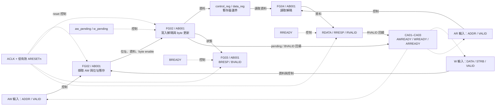
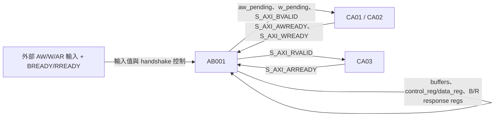
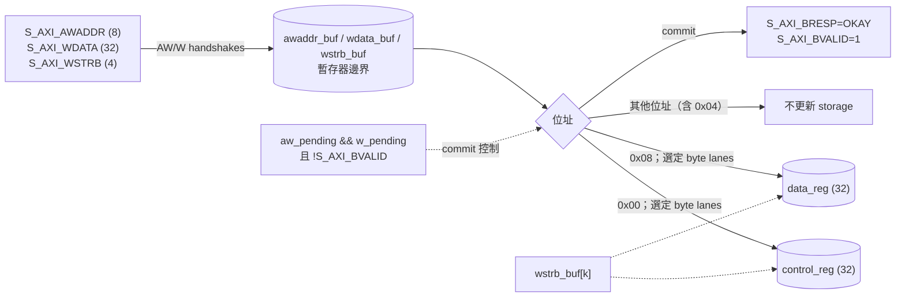
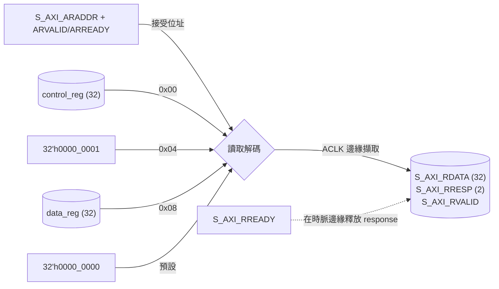

# RTL 架構文件 — `axi_lite_regs`

- **來源版本：** `90d46c1568586c0d4c4c59f1eb43990395c2e94d`（儲存庫 `HEAD`；工作目錄另有未追蹤的課程檔案）
- **分析日期：** 2026-11-01
- **RTL 檔案：** [`axi_lite_regs.v`](./axi_lite_regs.v)
- **已檢視的測試平台／波形：** [`tb_axi_lite_regs.v`](./tb_axi_lite_regs.v)、[`wave.vcd`](./wave.vcd)
- **範圍：** 靜態檢視完整的 72 行 Verilog-2005 DUT、單一 directed testbench，以及提供的 Icarus VCD。未提供套件、include、參數、子模組、編譯巨集、合成輸出，或 README 以外的規格文件。
- **限制：** 未執行 elaboration、lint、formal、CDC 或硬體驗證。VCD 僅涵蓋提供的 directed test；測試平台讓 AW/W 同時到達，沒有測試 RTL 註解所述的 AW/W 獨立到達順序。本文僅作為功能理解輔助，不代表已完成 AXI 相容性認證。

## 1. 模組總覽

| 欄位 | 說明 |
|---|---|
| 模組名稱 | `axi_lite_regs` |
| 用途 | 小型單時脈 AXI-Lite 風格暫存器組，包含分離的寫入位址、寫入資料、寫入回應、讀取位址與讀取回應通道。 |
| 來源 | [`axi_lite_regs.v`](./axi_lite_regs.v)，第 2 行的模組宣告 |
| 版本 | 上述儲存庫 `HEAD`；沒有可用的來源專屬 tag 或 commit。 |
| 參數 | 無。 |
| 介面 | 8-bit byte address、32-bit 寫入／讀取資料、4-bit 寫入 strobe、AXI-Lite 風格 VALID/READY 與 2-bit response。 |
| 時脈 | `ACLK`；testbench 的 `clk` 每 5 ns 翻轉一次（100 MHz）。RTL 未指定硬體時脈頻率。 |
| Reset | `ARESETn`，低有效且**同步**：只在 `always @(posedge ACLK)` 內檢查（第 26–33 行）。 |
| 時脈域 | 單一 `ACLK` 時脈域。提供的 RTL 未發現 CDC 電路或非同步輸入。 |
| 相依項目 | Verilog-2005；無外部模組或套件。Testbench 使用 Icarus 相容的 system task。 |
| 主要功能 | 控制通道 ready；分別暫存 AW 與 W；完成一筆寫入並更新 byte lane；回傳 OKAY 寫入回應；解碼讀取位址並回傳資料；等待讀取回應被接受。 |

### 暫存器位址表

| Byte address | 暫存器 | 存取權限 | 行為 |
|---|---|---|---|
| `0x00` | `control_reg` | 讀／寫 | Reset 為 0；寫入只更新 strobe 指定的 byte lane。 |
| `0x04` | STATUS | 唯讀 mock | 讀取固定回傳 `32'h0000_0001`；寫入會忽略，但仍回傳 OKAY。 |
| `0x08` | `data_reg` | 讀／寫 | Reset 為 0；寫入只更新 strobe 指定的 byte lane。 |
| 其他 | 保留位址 | — | 寫入忽略並回傳 OKAY；讀取回傳 0 並回傳 OKAY。 |

### 已由 RTL 確認的操作順序

1. 每逢 `ACLK` 上升緣且 `ARESETn == 0`，同步清除狀態與回應輸出。
2. AW 與 W handshake 各自擷取位址、資料／strobe。對應 pending flag 已設定，或寫入回應仍在等待接受時，ready 邏輯會阻止同一子通道再接受資料。
3. 若兩個 pending flag 在該上升緣前都已設定，且 B response 尚未有效，process 會更新可寫入的目標暫存器、清除 pending flags，並拉高 `S_AXI_BVALID`。
4. B response 會維持有效，直到某個上升緣取樣到 `S_AXI_BVALID && S_AXI_BREADY`。
5. AR handshake 會擷取所選讀取值並拉高 `S_AXI_RVALID`；讀取回應會維持有效，直到某個上升緣取樣到 `S_AXI_RVALID && S_AXI_RREADY`。

Testbench 一次只送一筆交易，AW/W 同時送出，且只短暫延遲 response backpressure。測試包含初始值、固定 STATUS、完整寫入、單一 byte 遮罩寫入，以及 STATUS 寫入忽略（[`tb_axi_lite_regs.v`](./tb_axi_lite_regs.v)，第 62–76 行）。RTL 支援 AW/W 分開到達以及長時間 backpressure 的說法，並未由這份波形驗證。

## 2. 介面參考

所有 port 宣告位於 [`axi_lite_regs.v`](./axi_lite_regs.v)，第 3–10 行。除純組合輸出由狀態推導外，訊號皆在 `ACLK` 時脈域取樣或更新。

| 訊號 | 方向 | 寬度 | 時脈域 | 說明 |
|---|---|---:|---|---|
| `ACLK` | 輸入 | 1 | Clock | 上升緣時脈。 |
| `ARESETn` | 輸入 | 1 | `ACLK` 同步取樣的控制訊號 | 低有效 reset；不是非同步 reset。 |
| `S_AXI_AWADDR` | 輸入 | 8 | ACLK 介面 | 寫入 byte address；AW handshake 時擷取。 |
| `S_AXI_AWVALID` / `S_AXI_AWREADY` | 輸入／輸出 | 1／1 | ACLK 介面 | AW 請求／組合式 ready。 |
| `S_AXI_WDATA` | 輸入 | 32 | ACLK 介面 | 寫入資料；W handshake 時擷取。 |
| `S_AXI_WSTRB` | 輸入 | 4 | ACLK 介面 | 寫入的 byte enable。 |
| `S_AXI_WVALID` / `S_AXI_WREADY` | 輸入／輸出 | 1／1 | ACLK 介面 | W 資料請求／組合式 ready。 |
| `S_AXI_BVALID` / `S_AXI_BREADY` | 輸出／輸入 | 1／1 | ACLK 介面 | 寫入回應有效／接受回應。 |
| `S_AXI_BRESP` | 輸出 | 2 | ACLK 介面 | 每次寫入 commit 設為 `2'b00`（OKAY）；reset 為 0。 |
| `S_AXI_ARADDR` | 輸入 | 8 | ACLK 介面 | 讀取 byte address；AR handshake 時解碼。 |
| `S_AXI_ARVALID` / `S_AXI_ARREADY` | 輸入／輸出 | 1／1 | ACLK 介面 | 讀取請求／組合式 ready。 |
| `S_AXI_RDATA` | 輸出 | 32 | ACLK 介面 | 註冊後的讀取結果；reset 為 0。 |
| `S_AXI_RRESP` | 輸出 | 2 | ACLK 介面 | 接受讀取請求時設為 `2'b00`；reset 為 0。 |
| `S_AXI_RVALID` / `S_AXI_RREADY` | 輸出／輸入 | 1／1 | ACLK 介面 | 讀取回應有效／接受回應。 |

訊號命名與 handshake 模式類似 AXI-Lite，但本文不宣稱已完整符合 AXI-Lite protocol。RTL 僅比對 `0x00`、`0x04` 與 `0x08` 這幾個確切位址。

## 3. 功能架構

三個 `assign` 是連續組合式 ready 方程式（第 20–24 行）。所有循序行為都在同一個並行 process `AB001` 中；下列功能群組是對單一 process 內部責任的分類，不代表多個獨立 process。

| 群組 | 名稱 | 責任 | 重要輸入 | 狀態／輸出 | 區塊 |
|---|---|---|---|---|---|
| FG01 | 通道 ready 控制 | 避免同一時間有多筆未完成的讀／寫請求。 | `aw_pending`、`w_pending`、`S_AXI_BVALID`、`S_AXI_RVALID` | `S_AXI_AWREADY`、`S_AXI_WREADY`、`S_AXI_ARREADY` | `CA01`–`CA03`、`AB001` |
| FG02 | 寫入擷取與暫存器更新 | 分別擷取 AW 與 W；合併 pending 的資料；選擇目標暫存器並套用 `WSTRB`。 | AW/W ports、pending flags、BVALID | `awaddr_buf`、`wdata_buf`、`wstrb_buf`、`control_reg`、`data_reg`、pending flags | `AB001` |
| FG03 | 寫入回應 | 寫入 commit 時產生 OKAY B response，並維持有效直到被接受。 | Pending flags、`S_AXI_BVALID`、`S_AXI_BREADY` | `S_AXI_BVALID`、`S_AXI_BRESP` | `AB001` |
| FG04 | 讀取解碼與回應 | AR handshake 時擷取暫存器／常數／預設資料，並維持回應有效。 | AR channel、`control_reg`、`data_reg`、`S_AXI_RVALID`、`S_AXI_RREADY` | `S_AXI_RDATA`、`S_AXI_RRESP`、`S_AXI_RVALID` | `AB001` |
| FG05 | 同步 reset | 清除暫存器組、暫存資料、flags 與 response outputs。 | `ACLK`、`ARESETn` | 除 loop variable `k` 與未使用的 `masked_value` 以外，所有循序狀態與 response registers | `AB001` |

**功能方塊圖**（來源版本見文件開頭）：



圖例：實線表示資料或狀態更新；虛線表示控制、ready 或 reset 相依關係。暫存器方框表示循序狀態，不代表實體實作邊界。設計只有 `ACLK` 一個時脈域。Ready 方程式是連續指派；圖中分類不表示它們是獨立模組。

## 4. Always 區塊清單

### 4.1 摘要

| 區塊 | 來源 | 建構式／事件 | Reset | 群組 | 用途 |
|---|---|---|---|---|---|
| AB001 | [`axi_lite_regs.v`](./axi_lite_regs.v#L26)，第 26–70 行 | `always @(posedge ACLK)` | process 內部的 `if (!ARESETn)`；低有效、同步 | FG02–FG05；使用 FG01 ready | Reset、擷取／commit 寫入、產生 B response、解碼／讀取並產生 R response。 |

DUT 中沒有 `always_comb`、`always_ff`、`initial`、function、task 或 FSM。`CA01`–`CA03` 是為了導覽而標記的連續指派，不是 procedural block。

### 4.2 區塊詳細說明

**AB001 — 循序暫存器介面**

| 屬性 | 內容 |
|---|---|
| 來源 | [`axi_lite_regs.v`](./axi_lite_regs.v#L26)，第 26–70 行 |
| 建構式 | `always @(posedge ACLK)` |
| 事件／時脈 | 原始事件表達式：`posedge ACLK` |
| Reset | `ARESETn`；低有效條件，與 `ACLK` 同步 |
| 群組 | FG02、FG03、FG04、FG05；讀取 FG01 的 ready 訊號 |
| 讀取訊號 | `ARESETn`、`S_AXI_AWVALID`、`S_AXI_AWREADY`、`S_AXI_AWADDR`、`S_AXI_WVALID`、`S_AXI_WREADY`、`S_AXI_WDATA`、`S_AXI_WSTRB`、`aw_pending`、`w_pending`、`S_AXI_BVALID`、`S_AXI_BREADY`、`S_AXI_ARVALID`、`S_AXI_ARREADY`、`S_AXI_ARADDR`、`S_AXI_RVALID`、`S_AXI_RREADY`、`control_reg`、`data_reg` |
| 寫入訊號 | `control_reg`、`data_reg`、`awaddr_buf`、`wdata_buf`、`wstrb_buf`、`aw_pending`、`w_pending`、`S_AXI_BVALID`、`S_AXI_BRESP`、`S_AXI_RVALID`、`S_AXI_RRESP`、`S_AXI_RDATA`、`k` |
| 指派風格 | 狀態／輸出使用 nonblocking (`<=`)；`for` 迴圈中的 `k` 使用 blocking (`=`)。 |
| 用途 | 實作同步暫存器組、讀寫 handshake 與 response 維持。 |
| 相關邏輯 | 第 21–24 行的 `CA01` (`AWREADY`)、`CA02` (`WREADY`)、`CA03` (`ARREADY`)。 |

- **行為：** Reset 分支清除所列狀態與 response。否則 AW/W handshake 各自擷取資料。當兩個**先前已儲存**的 pending flags 都為真且 BVALID 為假時，位址解碼會更新 CONTROL 或 DATA 的 byte lanes 並拉高 BVALID，同時清除 pending flags。若舊的 BVALID 值為真且取樣到 BREADY，則清除 BVALID。AR handshake 會擷取讀取結果並拉高 RVALID；若舊的 RVALID 值為真且取樣到 RREADY，則清除 RVALID。
- **更新條件：** 循序狀態／輸出只會在上升緣改變。寫入 commit 要求兩個 pending flags 在該上升緣前已設定；讀取要求 `ARVALID && ARREADY`；response valid 會在對應的 VALID/READY 條件成立時清除。
- **保持／預設行為：** 未被指派的 nonblocking 暫存器會保留原值。寫入 STATUS／保留位址時，不更新可寫暫存器，但仍產生 OKAY response。讀取未列出的位址會明確擷取零。
- **相依關係：** Ready 方程式透過 pending 與 response-valid 狀態計算。Process 會在後續時脈邊緣讀取自己的狀態；這是循序回饋，不是不同 block 間的執行順序。
- **RTL 注意事項：** Nonblocking 指派的 RHS 在觸發事件時取值，並在 process evaluation 後更新。因此 AW 和 W 若在同一個上升緣被接受，該緣不能使用剛設定的 pending flags 進行 commit；commit 會在後續上升緣發生。若同一個時脈邊緣同時讀寫同一個 storage，讀取解碼的 RHS 會看到更新前的暫存值。雖然 reset 為低有效，但它是同步 reset。B/R response 只在各自交易事件時設定為 OKAY，其他時候維持原值。`masked_value` 在提供的模組中有宣告但沒有讀取或指派；`k` 是 blocking 指派的整數迴圈變數，且沒有 reset。
- **信心程度：** RTL 可直接確認；波形中實際觀察到的行為另見第 7 節。

## 5. 訊號相依與資料流程

### 5.1 訊號相依表

下表的「驅動／指派位置」是 RTL 中找到的指派位置，不代表已確認合成後 netlist driver。輸入 port 的來源在模組外部。

| 訊號 | 寬度／種類 | 指派位置 | 使用者 | 時脈／時脈域 | 用途 |
|---|---|---|---|---|---|
| `ACLK`、`ARESETn` | 1-bit input | 外部 | AB001 event/reset 分支 | `ACLK`；reset 同步取樣 | 時脈與低有效 reset。 |
| `S_AXI_AWADDR`、`S_AXI_AWVALID` | 8、1-bit input | 外部 | AB001 | ACLK 介面 | 寫入位址與請求。 |
| `S_AXI_AWREADY` | 1-bit output wire | CA01，第 21 行 | 外部；AB001 handshake 判斷 | 由狀態組合產生 | `!aw_pending && !S_AXI_BVALID`。 |
| `S_AXI_WDATA`、`S_AXI_WSTRB`、`S_AXI_WVALID` | 32、4、1-bit input | 外部 | AB001 | ACLK 介面 | 寫入資料、byte enable 與請求。 |
| `S_AXI_WREADY` | 1-bit output wire | CA02，第 22 行 | 外部；AB001 handshake 判斷 | 由狀態組合產生 | `!w_pending && !S_AXI_BVALID`。 |
| `awaddr_buf`、`wdata_buf`、`wstrb_buf` | 8、32、4-bit reg | AB001 第 35、39–40 行；reset 第 29 行 | AB001 commit／解碼 | ACLK | 暫存的寫入位址／資料／strobe。 |
| `aw_pending`、`w_pending` | 各 1-bit reg | AB001 第 36、41、53–54 行；reset 第 30 行 | CA01/CA02、AB001 commit 判斷 | ACLK | 表示分別擷取到的寫入通道資料。 |
| `control_reg`、`data_reg` | 32-bit reg | AB001 第 28、48、50 行 | AB001 讀取；外部僅透過 RDATA | ACLK | 可寫入的暫存器儲存區。 |
| `S_AXI_BVALID` | 1-bit output reg | AB001 第 31、44、56 行 | CA01/CA02、外部 | ACLK | 寫入 response 是否可用／backpressure 狀態。 |
| `S_AXI_BRESP` | 2-bit output reg | AB001 第 31、45 行 | 外部 | ACLK | 寫入 response code；接受的 commit 一律為 OKAY。 |
| `S_AXI_BREADY` | 1-bit input | 外部 | AB001 第 56 行 | ACLK 介面 | 接受有效的 B response。 |
| `S_AXI_ARADDR`、`S_AXI_ARVALID` | 8、1-bit input | 外部 | AB001 | ACLK 介面 | 讀取位址與請求。 |
| `S_AXI_ARREADY` | 1-bit output wire | CA03，第 24 行 | 外部；AB001 handshake 判斷 | 由狀態組合產生 | `!S_AXI_RVALID`。 |
| `S_AXI_RDATA`、`S_AXI_RRESP`、`S_AXI_RVALID` | 32、2、1-bit output reg | AB001 reset 第 32 行；讀取第 59–65 行；valid 清除第 68 行 | 外部；CA03 使用 RVALID | ACLK | 註冊後的讀取 response。 |
| `S_AXI_RREADY` | 1-bit input | 外部 | AB001 第 68 行 | ACLK 介面 | 接受有效的 R response。 |
| `k` | integer | AB001 第 47、49 行的 `for` 迴圈 | AB001 迴圈索引 | Procedural loop variable | 遍歷四個 byte lanes。 |
| `masked_value` | 32-bit reg | 找不到指派 | 找不到讀取 | 未確認 | 來源中的未使用宣告。 |

### 5.2 區塊相依圖



圖例：`A → B` 表示 B 會讀取由 A 指派的值；AB001 的自我連線代表在後續觸發邊緣讀取狀態（有暫存器邊界）。CA→AB 回饋表示組合式 ready 訊號會送回 handshake 判斷。這些連線表示相依性，不代表執行順序。設計中只有一個 procedural process；未發現多個 procedural process 同時指派同一變數。

### 5.3 資料流程圖

**寫入資料路徑**（FG02；AB001）：



`wstrb_buf[k]` 啟用第 `k` 個 byte；未啟用的 lane 保留舊值。即使寫入位址被忽略，write commit 仍會產生 response。

**讀取資料路徑**（FG04；AB001）：



讀取值會在 AR handshake 被取樣時註冊。若同一上升緣同時讀取並寫入同一暫存器，依 nonblocking assignment 語意，讀取 RHS 會取得舊值。

## 6. 控制流程與 FSM

### FSM 分析

沒有明確的 state register、enumerated state type 或 next-state machine。`aw_pending`、`w_pending`、`S_AXI_BVALID` 與 `S_AXI_RVALID` 是 handshake／狀態 bits，RTL 未將其定義為編碼 FSM；因此不繪製 FSM 狀態圖。

### 非 FSM 控制

寫入流程（FG02／FG03）：

1. 每次 AW/W handshake 分別儲存其資料並設定對應 pending flag。
2. Pending 時，ready 方程式會阻止同一通道再次擷取；`S_AXI_BVALID` 有效期間也會阻止 AW、W 兩個通道接受新資料。
3. 後續某個上升緣若兩個 pending flags 都已設定且 B response 尚未有效，就會 commit 指定暫存器、清除 flags、設定 `BRESP=OKAY`，並拉高 BVALID。
4. 後續上升緣若 BVALID 與 BREADY 同時有效，便清除 BVALID。

讀取流程（FG04）：

1. `S_AXI_RVALID` 為低時，`ARREADY` 為高。
2. `ARVALID && ARREADY` 成立時，由位址選取暫存器／常數／預設值；RDATA/RRESP 被擷取，且 RVALID 設為高。
3. 後續上升緣若 RVALID 與 RREADY 同時有效，便清除 RVALID。RVALID 為高期間，ARREADY 為低。

## 7. 時序與交易範例

波形取自提供的 Icarus 執行結果，VCD timescale 為 1 ps，testbench 時脈週期為 10 ns。播放器使用精確別名 DUT 路徑 `tb_axi_lite_regs.dut.ACLK`，並以 posedge 作為有效邊緣。邊緣顯示值採用該 timestamp 中**最後一筆 VCD 變更**作為快照。這只是 timestamp 快照，不代表模擬器排程區域的先後順序。

**波形觀察到的寫入範例 — 完整寫入 CONTROL**（`0x12345678`，strobe `0xF`）：

| VCD 時間 | 觀察結果 |
|---:|---|
| 130 ns | Testbench 在下降緣拉高 AWVALID/WVALID，並提供位址、資料與 strobe。 |
| 135 ns | 上升緣取樣並緩衝 AW/W；pending flags 在邊緣後更新。 |
| 145 ns | Commit 邊緣：CONTROL 變成 `0x12345678`，BVALID 拉高，BRESP 為 OKAY。 |
| 150 ns | Testbench 拉高 BREADY。 |
| 155 ns | 上升緣取樣到 B handshake；邊緣後 BVALID 清除。 |

```text
ACLK 上升緣：       135 ns       145 ns       155 ns
接受 AW/W：          是
commit/control_reg：              12345678
BVALID：              0             1            0
BREADY：              0             0            1
```

**波形觀察到的讀取範例 — 寫入後讀取 CONTROL**：

| VCD 時間 | 觀察結果 |
|---:|---|
| 170 ns | 在下降緣以位址 `0x00` 拉高 ARVALID。 |
| 175 ns | 上升緣取樣 AR handshake；RDATA 變成 `0x12345678`，RVALID 拉高。 |
| 190 ns | Testbench 檢查完 response 後拉高 RREADY。 |
| 195 ns | 上升緣取樣 R handshake；邊緣後 RVALID 清除。 |

在這次測試中，AR 邊緣後即可看到 response data，而 testbench 會延遲一段時間才拉高 READY。上述時間與數值是波形觀察結果，不能證明所有時序組合或 protocol corner cases。

## 8. 重要暫存器與訊號參考

| 訊號 | 寬度 | Reset 值 | 更新條件 | 時脈／時脈域 | 功能 | 區塊 |
|---|---:|---|---|---|---|---|
| `control_reg` | 32 | 0 | Reset；寫入 `0x00` commit 時更新已啟用的 byte lanes | ACLK | CONTROL storage | AB001 |
| `data_reg` | 32 | 0 | Reset；寫入 `0x08` commit 時更新已啟用的 byte lanes | ACLK | DATA storage | AB001 |
| `awaddr_buf` | 8 | 0 | Reset；AW handshake | ACLK | 暫存寫入位址 | AB001 |
| `wdata_buf` | 32 | 0 | Reset；W handshake | ACLK | 暫存寫入資料 | AB001 |
| `wstrb_buf` | 4 | 0 | Reset；W handshake | ACLK | 暫存 byte enables | AB001 |
| `aw_pending`、`w_pending` | 各 1 | 0 | Reset；對應通道擷取時設為 1；合併 commit 成功時清除 | ACLK | 追蹤分別擷取的通道資料 | AB001 |
| `S_AXI_BVALID` | 1 | 0 | Reset；commit 時設為 1；BVALID/BREADY handshake 時清除 | ACLK | 寫入 response 有效旗標 | AB001 |
| `S_AXI_BRESP` | 2 | 0 | Reset；write commit 時設定 OKAY | ACLK | 寫入 response code | AB001 |
| `S_AXI_RDATA` | 32 | 0 | Reset；AR handshake 時擷取解碼結果 | ACLK | 讀取 response payload | AB001 |
| `S_AXI_RRESP` | 2 | 0 | Reset；AR handshake 時設定 OKAY | ACLK | 讀取 response code | AB001 |
| `S_AXI_RVALID` | 1 | 0 | Reset；AR handshake 時設為 1；RVALID/RREADY handshake 時清除 | ACLK | 讀取 response 有效旗標 | AB001 |

Reset 值皆直接指派於 reset 分支。設計中沒有獨立 FSM state。

## 9. 程式碼導覽

| 群組 | 區塊 ID | 來源位置 | 搜尋錨點 | 重要訊號 |
|---|---|---|---|---|
| FG01 | CA01–CA03；AB001 | [`axi_lite_regs.v`](./axi_lite_regs.v#L20)，第 20–24 行；handshake 使用處在第 34、38、58 行 | `S_AXI_AWREADY`、`S_AXI_WREADY`、`S_AXI_ARREADY` | pending flags、BVALID/RVALID |
| FG02 | AB001 | [`axi_lite_regs.v`](./axi_lite_regs.v#L34)，第 34–55 行 | `aw_pending && w_pending` | 位址／資料／strobe buffers、暫存器組 |
| FG03 | AB001 | [`axi_lite_regs.v`](./axi_lite_regs.v#L43)，第 43–56 行 | `S_AXI_BVALID` | BVALID、BRESP、BREADY |
| FG04 | AB001 | [`axi_lite_regs.v`](./axi_lite_regs.v#L58)，第 58–68 行 | `S_AXI_ARVALID && S_AXI_ARREADY` | ARADDR、RDATA、RRESP、RVALID |
| FG05 | AB001 | [`axi_lite_regs.v`](./axi_lite_regs.v#L26)，第 26–33 行 | `if (!ARESETn)` | reset 分支指派的所有狀態／response registers |
| 測試情境 | TB process／task | [`tb_axi_lite_regs.v`](./tb_axi_lite_regs.v#L62)，第 62–76 行 | `$dumpvars`、`read_check`、`write_reg` | 所有 stimulus／check 訊號 |

行號對應文件開頭所列的來源版本；後續修改可能造成行號變動。

## 10. 風險、待確認問題與檢視備註

- **已確認：** 寫入 STATUS 或保留位址時，模組回傳 OKAY；只有確切位址 `0x00` 與 `0x08` 會變更 storage。
- **已確認：** `masked_value` 有宣告，但本來源中沒有讀取或指派。可考慮移除，或記錄其預定用途。
- **潛在問題／需要設計負責人確認：** 除確切位址比對外，沒有明確檢查對齊或位址位元。未對未對齊位址定義預期行為；目前會當成保留位址處理。
- **需要設計負責人確認：** RTL 註解指出 AW 和 W 可用不同順序到達。DUT 看起來會分別緩衝，但 testbench 只同時送出。建議新增 AW-first 與 W-first directed tests，並確認交易順序與 backpressure 預期。
- **需要設計負責人確認：** 讀寫位於同一 process。若同一上升緣讀取並寫入相同位置，讀取會得到 nonblocking assignment 更新前的值。請確認這是否符合預期的 read-during-write 行為。
- **未評估：** AXI-Lite protocol 相容性、合成推論、時序收斂、reset 整合與 CDC 均未驗證。建議後續先執行 lint/elaboration，再新增 handshake、AW/W 分開到達、長時間 B/R backpressure、同時讀寫，以及交易中 reset 等模擬。
- **未評估：** 除提供的執行結果外，VCD 是否完整。動畫會顯示時間戳，並保留未知值與高阻抗值，不會將其轉換成二進位值。

## 11. 驗證與版本紀錄

- 已檢視完整 DUT、testbench、README 與 VCD 標頭／結尾。DUT 有一個 procedural process 與三個 ready continuous assignments。
- 來源基準：儲存庫 `HEAD` 為 `90d46c1568586c0d4c4c59f1eb43990395c2e94d`；提供的 VCD 標示 Icarus Verilog，並於 440,000 ps 結束。
- 架構解讀來自 RTL 靜態分析；時序範例直接取自 VCD 訊號變化。
- 在隔離的暫存目錄中完成 Icarus 編譯與 testbench 執行（`ALL TESTS PASSED`）；未覆寫專案中的 `wave.vcd`。
- 已在瀏覽器以提供的 trace 測試本機動畫：偵測到 44 個 ACLK 上升緣；cycle／timestamp seek、前進／後退、播放／暫停、來源脈絡、初始 `x` 值、完整寫入與 byte 遮罩寫入快照皆符合波形。

**新進工程師建議閱讀順序：** 先讀第 1–3 節，再依資料流程圖追蹤 FG02 與 FG04。接著閱讀 AB001，並在 [`waveform_explorer.html`](./waveform_explorer.html) 中逐步檢視對應事件。離線動畫可載入本 VCD，支援播放、前後移動 ACLK 上升緣、edge／timestamp 尋址，以及訊號到來源碼的導覽。修改 handshake 或讀寫行為前，請先閱讀第 10 節的風險與待確認事項。
